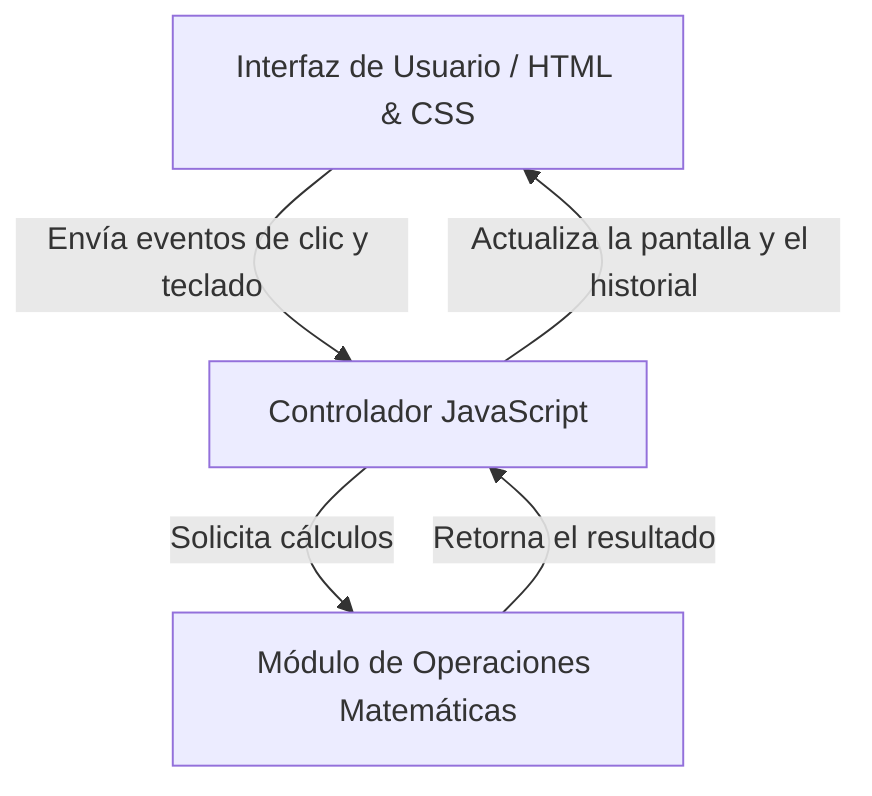

# Calculadora Interactiva en Línea

Una aplicación web interactiva que permite realizar operaciones matemáticas básicas directamente desde el navegador, rediseñada aplicando principios de UX/UI.


Página publicada: https://johnarizapana.github.io/laboratorio-readme/

## Tabla de contenidos
- [Descripción](#descripción)
- [Instalación](#instalación)
- [Uso](#uso)
- [Funcionalidades](#funcionalidades)
- [Cambios de UX/UI](#cambios-de-uxui)
- [Arquitectura del Proyecto](#arquitectura-del-proyecto)
- [Contribuidores](#contribuidores)

## Descripción
Este proyecto consiste en una calculadora web que resuelve problemas aritméticos comunes en tiempo real. Su objetivo principal es ofrecer una herramienta accesible y veloz para estudiantes.

## Instalación
Para clonar y ejecutar este proyecto de forma local, ejecuta los siguientes comandos en tu terminal:

```bash
git clone https://github.com/johnarizapana/laboratorio-readme.git
cd laboratorio-readme
```

Abre `index.html` en el navegador (o usa la extensión Live Server de VS Code).

## Uso
Una vez abierta la aplicación:
1. Introduce los valores numéricos mediante los botones de la interfaz o el teclado.
2. Selecciona la operación matemática deseada (`+`, `−`, `×`, `÷`).
3. Pulsa **Calcular**. El resultado se guarda en el historial.

## Funcionalidades

| Funcionalidad | Estado |
| :--- | :--- |
| Operaciones básicas | Completo |
| Historial de cálculos (últimos 7, guardado en el navegador) | Completo |
| Borrar historial con opción de deshacer | Completo |
| Uso completo con teclado | Completo |
| Soporte de Modo Oscuro | Pendiente |

### Lista de Tareas Pendientes
- [x] Diseñar la interfaz de usuario responsiva.
- [x] Implementar la lógica matemática básica.
- [x] Guardar el historial en el navegador.
- [ ] Modo oscuro.

## Cambios de UX/UI

| Principio | Cambio |
|-----------|--------|
| Visibilidad del estado | Mensaje tras cada acción |
| Prevención de errores | «Calcular» desactivado si faltan datos o se divide entre 0 |
| Control y libertad | Botón Deshacer tras borrar el historial |
| Ley de Fitts | Botón «Calcular» grande y teclas de 48 px |
| Ley de Hick | Teclas agrupadas por tipo y color |
| Ley de Miller | Historial limitado a 7 cálculos |
| Accesibilidad | `aria-label`, contraste mayor a 4.5:1 y foco visible |

La auditoría completa está en [docs/AUDITORIA-UX.md](docs/AUDITORIA-UX.md).

## Arquitectura del Proyecto
Flujo técnico de los componentes del proyecto:



## Contribuidores
* John Ricardo Arizapana Flores - [@johnarizapana](https://github.com/johnarizapana)
